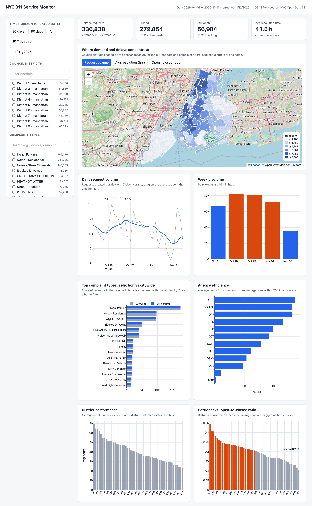
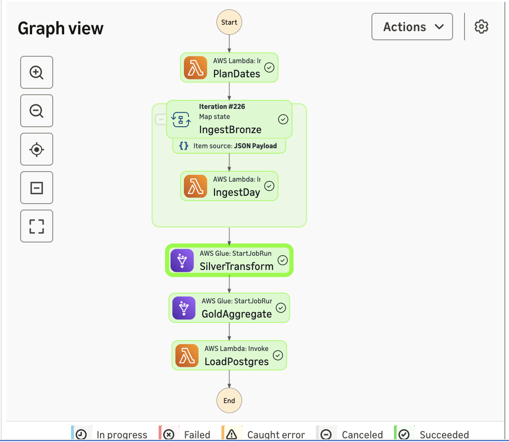
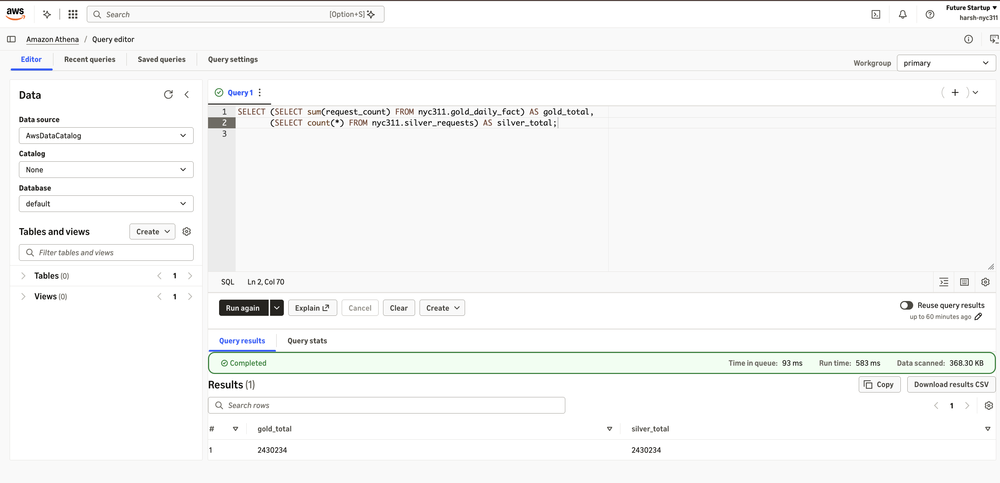

# NYC 311 Service Request Pipeline on AWS

An end-to-end Medallion (Bronze → Silver → Gold) pipeline over the NYC 311 Service Requests dataset (`erm2-nwe9`), built only on AWS services. It ingests every request created on or after **2026-04-01** from the SODA3 API, cleans and validates it with PySpark, aggregates it into business tables, serves them from PostgreSQL, and presents them in an interactive dashboard. Step Functions runs the whole flow, and it refreshes daily.

**Live dashboard:** http://nyc311-dashboard-919542772040.s3-website.us-east-2.amazonaws.com



## Architecture

```
NYC Open Data SODA3 API  (POST /api/v3/views/erm2-nwe9/query.json, X-App-Token)
        │  one calendar day per call, paged, retried
        ▼
Lambda  nyc311-ingest-bronze  ──►  S3 bronze/   raw gzipped JSON Lines + manifest per day
        │
Glue 5.0 PySpark  nyc311-silver  ──►  S3 silver/   typed, validated Parquet, partitioned by created_year / created_month
        │                                          + quarantine/  + dq_reports/
Glue 5.0 PySpark  nyc311-gold    ──►  S3 gold/     6 aggregate tables (Parquet for Athena, CSV for Postgres)
        │
Lambda  nyc311-load-gold (in VPC) ──►  RDS PostgreSQL 16  (schema gold, indexed)
        │
API Gateway HTTP API ──► Lambda nyc311-api (in VPC, read-only DB role)
        │
S3 static website: index.html (Plotly charts + Leaflet map)

Orchestration: Step Functions nyc311-pipeline   PlanDates → Map(IngestDay ×4 parallel) → Silver → Gold → LoadPostgres
Schedule:      EventBridge Scheduler, daily 06:15 America/New_York, re-fetches the last 7 days
Validation:    Athena over Silver and Gold (Glue Data Catalog, partition projection)
Region:        us-east-2 (Ohio)
```



## How the brief maps to the build

| Requirement | Implementation |
| --- | --- |
| SODA3 API, Python, own app token | `lambdas/ingest_bronze/handler.py` calls the v3 `query.json` endpoint with `X-App-Token`; token stored in SSM Parameter Store (SecureString) |
| Only records created on/after 2026-04-01 | SoQL `WHERE created_date >= …` per day; the Lambda rejects any earlier date; Silver quarantines anything earlier |
| Raw data in a Bronze location | `s3://…/bronze/nyc311/created_date=YYYY-MM-DD/data.jsonl.gz` + `_manifest.json` |
| Validation and standardization | `glue/silver_transform.py` (rules below) |
| Resolution time | `resolution_hours = closed_ts − created_ts` for valid closed cases |
| Partitioned Parquet | Silver partitioned by `created_year` / `created_month`, sorted by district and complaint type within partitions |
| District performance, complaint distribution, agency efficiency, temporal trends, bottlenecks | One Gold table each, plus `gold_daily_fact` for dashboard filtering |
| PostgreSQL with indexes | RDS PostgreSQL 16, `sql/postgres_schema.sql` |
| Interactive HTML dashboard with district, complaint type and time filters; spatial, temporal and categorical views | `dashboard/index.html` |

**Interpretation of the brief.** The brief mentions a local directory and a local PostgreSQL; because the assignment asks for AWS services only, Bronze lives in S3 and PostgreSQL runs on Amazon RDS.

## Results of the full backfill

| Stage | Rows |
| --- | --- |
| Bronze (2026-04-01 → 2026-11-11, one file per day) | 2,430,234 |
| Silver | 2,430,234 (0 quarantined, 0 duplicates) |
| `gold_daily_fact` | 542,219 |
| `gold_complaint_distribution` | 7,342 |
| `gold_temporal_trends` | 258 (225 days + 33 weeks) |
| `gold_district_performance` | 52 (51 districts + unknown) |
| `gold_bottlenecks` | 51 |
| `gold_agency_efficiency` | 15 |

NYC publishes 311 data with roughly a one-day delay, so the most recent complete day is the day before a run.

## Silver: validation and standardization

| Rule | Action | Count in full run |
| --- | --- | --- |
| Missing `unique_key`, unparseable `created_date`, created before 2026-04-01, missing complaint type or agency | Row moved to `quarantine/` with a reason | 0 |
| Same `unique_key` more than once | Keep the most recently updated version | 0 |
| Council district outside 1–51 | Value set to null, flagged | 0 |
| No council district | Kept in totals as district 0, excluded from the map | 62,751 (2.6%) |
| Latitude/longitude outside NYC bounding box | Values set to null, flagged | 0 |
| Closed date earlier than created date | Excluded from resolution metrics, flagged | 1,211 |
| Status and closed date disagree | Flagged; closed timestamp is the source of truth | 17,662 |
| Closed in zero seconds (likely auto-closed or referred) | Kept, flagged | 40,122 (1.6%) |

Other standardization: trimmed strings and one representation of missing (`N/A`, `NULL`, `UNSPECIFIED`, empty → null); complaint types grouped case-insensitively and published under their most common spelling; agency upper-cased with an alias map; ZIP codes cut to 5 digits; timestamps parsed in `America/New_York`.

Every run writes a JSON data-quality report to `dq_reports/`. The job fails, and the pipeline stops, if more than 5% of rows are quarantined, so bad data never reaches the dashboard.

**Partitioning.** Almost every query filters by date, so Silver is partitioned by month (about 300k rows per partition). Daily partitions would create ~225 small folders; district × day would create ~11,000. Sorting by district and complaint type inside each partition lets Parquet row-group statistics skip data for those filters too. Athena uses partition projection, so new months need no crawler.

**Timestamps.** Silver stores timestamps as UTC instants; `created_date`, `created_year` and `created_month` are derived in New York local time. Athena therefore displays `2026-04-01 04:00:06` for a request created at 00:00:06 New York time.

## Gold tables

| Table | Grain | Purpose |
| --- | --- | --- |
| `gold_district_performance` | council district | Volume, % closed, average / median / p90 resolution hours |
| `gold_complaint_distribution` | district × complaint type | District share and rank vs citywide share and rank, over-index ratio |
| `gold_agency_efficiency` | agency | Average / median / p90 resolution hours, % closed within 24 h |
| `gold_temporal_trends` | day and week | Volume, 7-day rolling average, top-5 peak flag |
| `gold_bottlenecks` | council district | Open-to-closed ratio vs the city ratio, bottleneck flag |
| `gold_daily_fact` | day × district × borough × complaint type × agency | Additive counts and summed hours behind every dashboard filter |

The fact table stores sums and counts, never averages, so any filtered average is computed correctly as `SUM(sum_resolution_hours) / SUM(closed_count)`.

## Serving layer

- RDS PostgreSQL 16 (`db.t4g.micro`, private, single-AZ), reachable only from the two in-VPC Lambdas through security-group rules.
- The loader runs `TRUNCATE` + `COPY` per table inside one transaction, so readers never see a partial load, then runs `ANALYZE`.
- Indexes: `(created_day)`, `(council_district, created_day)`, `(complaint_type, created_day)`, `(agency)` on the fact table, and primary keys on the summary tables.
- The API connects as `dashboard_ro`, which can only `SELECT`; every filter is a bound query parameter.
- A free S3 gateway endpoint lets the in-VPC loader read Gold without a NAT gateway.

## Dashboard

- Filters: council districts (list, map click or chart click), complaint types (searchable list or chart click), and time horizon (30 / 90 days / all, date pickers, or drag-zoom on the daily chart).
- Spatial: council-district choropleth switchable between request volume, average resolution hours and open:closed ratio.
- Temporal: daily volume with 7-day average; weekly volume with peak weeks highlighted.
- Categorical: selection vs citywide complaint mix, agency resolution times, district resolution times, bottleneck districts against the city average.
- The URL stores the current filters, so a filtered view can be shared as a link.
- Downloads: every chart has a CSV button for the data behind it, and **Download filtered data** exports the daily rows (day × district × complaint type × agency) for the current filters through the API's `/export` route, capped at 50,000 rows per download.

The first and last bars of the weekly chart can be partial weeks when a date filter cuts through a week. Open-to-closed ratios are naturally higher for recent dates because newer cases have had less time to close.

## Validation with Athena

| Check | Result |
| --- | --- |
| Earliest / latest `created_ts` (UTC) | 2026-04-01 04:00:06 / 2026-11-12 04:59:58, i.e. 00:00:06 Apr 1 to 23:59:58 Nov 11 New York time |
| Duplicate `unique_key` | none |
| June via partition columns vs via `created_date` | both 334,834 rows |
| Gold total vs Silver total | 2,430,234 = 2,430,234 |



Queries are in `sql/athena.sql`.

## Security and cost

- App token in SSM SecureString; database passwords in Lambda environment variables (encrypted at rest). Production would move them to Secrets Manager with rotation, which needs a VPC interface endpoint.
- One IAM role per component with least-privilege inline policies (`iam/`).
- No NAT gateway, no Redshift, no interface endpoints. The only always-on cost is the micro RDS instance.

## Repository layout

| Path | Purpose |
| --- | --- |
| `lambdas/plan_dates/` | Lists the days to ingest (backfill or last 7 days) |
| `lambdas/ingest_bronze/` | SODA3 → S3 Bronze |
| `glue/silver_transform.py` | Silver job |
| `glue/gold_aggregate.py` | Gold job |
| `lambdas/load_gold/` | Gold CSV → PostgreSQL |
| `lambdas/api/` | Dashboard API (`/filters`, `/dashboard`, `/export`) |
| `sql/postgres_schema.sql` | Serving schema, indexes, read-only role |
| `sql/athena.sql` | Athena tables and validation queries |
| `stepfunctions/pipeline.asl.json` | State machine |
| `dashboard/` | Dashboard page, config, council district GeoJSON |
| `iam/` | Policy documents |
| `scripts/` | Build scripts and API smoke test |

## Deployment

All resources were created with the AWS CLI from AWS CloudShell in `us-east-2`, in this order:

1. SSM parameter `/nyc311/app_token`; S3 bucket `nyc311-lake-<account>` with public access blocked.
2. `bash scripts/build.sh` to build the Lambda zips and the `pg8000` layer.
3. Lambdas `nyc311-plan-dates` and `nyc311-ingest-bronze` (Python 3.12, arm64) with role `nyc311-ingest-role`.
4. Glue scripts uploaded to `s3://…/scripts/`; Glue 5.0 jobs `nyc311-silver` and `nyc311-gold` (G.1X × 2) with role `nyc311-glue-role`.
5. Security groups `nyc311-lambda-sg` and `nyc311-rds-sg` (5432 from the Lambda group only); S3 gateway endpoint; RDS instance `nyc311-db`.
6. Lambda layer `pg8000`; Lambda `nyc311-load-gold` in the VPC with role `nyc311-load-role`.
7. Lambda `nyc311-api` in the VPC; API Gateway HTTP API with CORS; public S3 website bucket for `dashboard/`.
8. Step Functions `nyc311-pipeline` with role `nyc311-sfn-role`; backfill run with input `{"mode": "backfill"}`; EventBridge schedule `nyc311-daily` with input `{"mode": "incremental"}`.

Both Glue scripts also run locally with `spark-submit glue/silver_transform.py --local --BUCKET ./lake`.

## Next steps

- Infrastructure as code (AWS CDK or CloudFormation) instead of CLI steps.
- Incremental Silver processing (Apache Iceberg with `MERGE`) instead of reprocessing all of Bronze each run.
- Secrets Manager with rotation for database credentials.
- CloudWatch alarms on pipeline failures and on the data-quality report.
- CloudFront with HTTPS in front of the dashboard.
- Unit tests and CI for the transformation logic.
